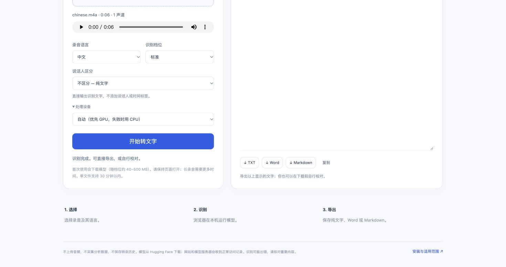

# Audio to Text

**MP3 / M4A → plain text. Chinese and English. Free, on your computer.**

[Open the web app](https://608tt.github.io/audio-to-text/) · [中文](README.zh-CN.md) · [Install locally](#run-locally) · [Speaker labels](#speaker-labels)

[](https://github.com/608tt/audio-to-text/actions/workflows/checks.yml)
[](LICENSE)

Choose a recording, choose Chinese or English, and click **Transcribe**.
Download **TXT**, **Word (.docx)** or **Markdown**. No account, API key,
subscription, summary, translation or automatic rewriting.



Audio decoding and recognition run in a browser worker on your own device.
The audio file is not sent to a transcription server. The first run downloads
open models from Hugging Face and caches them when browser storage permits.
The site and model hosts receive ordinary network metadata such as your IP.

## Quickest start

1. Open **[Audio to Text](https://608tt.github.io/audio-to-text/)** in current desktop Chrome or Edge.
2. Select an unprotected `.mp3`, `.m4a` (AAC) or `.wav` recording.
3. Choose its language; keep speaker labels off for plain text.
4. Click **Transcribe**, keep the tab open, and download the result.

Everything runs locally, with no per-minute charge. Initial model downloads
are tens to hundreds of MB depending on quality/device/speaker mode. Your computer
provides the processing power. CPU mode works without WebGPU; automatic mode
tries WebGPU and falls back to CPU. Recognition is not instantaneous.

## Speaker labels

| Mode | Use it for | Limits |
|---|---|---|
| Off (default) | Plain recognized text | No added speaker or time labels |
| Automatic (experimental) | Short recordings with different voices | At most 60 seconds and 3 modeled speakers; labels need checking |
| Stereo channels | Recordings with a different speaker on each channel | Exactly two channels; left/right labels are channel labels, not voice identification |

Automatic mode combines word-level Whisper timestamps with Pyannote
segmentation. It uses the standard timestamped model even if a different
quality was previously selected. Overlapping speaker predictions are retained;
missing timestamps or speech attribution are labeled unclear. It does not
identify a person's name. Speaker quality is not a measured accuracy guarantee.

See the [actual two-voice browser example](docs/speakers.jpg).

Ordinary stereo recordings often put the same room sound on both channels.
Channel mode cannot separate the people in those recordings. For long mono
meetings, use plain transcription or split clips for experimental speaker labels.

## Run locally

Install [Node.js 22 or newer](https://nodejs.org/), download the repository ZIP
or clone it, then run:

```sh
npm install --ignore-scripts
npm run dev
```

Open the localhost address printed in the terminal. No Python, FFmpeg, GPU,
cloud account or API key is required. Model downloads still need a working
connection to Hugging Face. A Git clone is optional.

For the production page:

```sh
npm run build
npm run preview
```

Only the web app is built. Do not open `index.html` directly as a `file://` URL;
browser modules and workers require an HTTP origin. See [deployment](docs/deployment.md).

## Exports and privacy

- TXT and Markdown contain the text shown in the editor, with no generated title or report.
- Word export is a real `.docx` file. Paragraphs and blank lines are retained;
  characters that XML cannot represent are removed.
- You can correct the text yourself before downloading. The app does not rewrite it.
- No transcript history, analytics, login or audio upload. Browser caches store models, not recordings.
- Page memory holds the selected recording until the tab closes or another file replaces it.
- Cancel stops the recognition worker; restarting may need to load its model again.

## Scope and verification

Desktop use is recommended. Each file is limited to **200 MB / 30 minutes** to
bound browser memory use; these are admission limits, not a claim that every
device has been tested with a 30-minute file. Mobile browsers can run out of
memory. Audio codec support depends on the browser; protected M4A files are
not supported. If decoding fails, convert the recording to ordinary MP3 or WAV.

Whisper can mishear names, omit words or hallucinate text in silence. Review
important transcripts. Chinese and English are supported by the selected
multilingual models; mixed-language recognition is not specially optimized.
Model-host availability and browser cache limits can affect first use.

```sh
npm test
npm run build
```

Regression tests cover file limits, audio mixing, speaker attribution,
uncertain/overlapping turns, channel ordering, filenames and all export formats.
See [the validation record](docs/validation.md) for actual audio checks and limits.

## Models and credits

Own app code: MIT. Model weights are downloaded, not included in this repository.
Uses [Transformers.js](https://github.com/huggingface/transformers.js),
[Whisper ONNX models](https://huggingface.co/onnx-community/whisper-base),
[timestamped Whisper](https://huggingface.co/onnx-community/whisper-base_timestamped),
[Pyannote segmentation](https://huggingface.co/onnx-community/pyannote-segmentation-3.0)
and [fflate](https://github.com/101arrowz/fflate).
The official browser diarization example informed the choice of models and API.
See [third-party notices](THIRD_PARTY_NOTICES.md) and [contribution guide](CONTRIBUTING.md).
